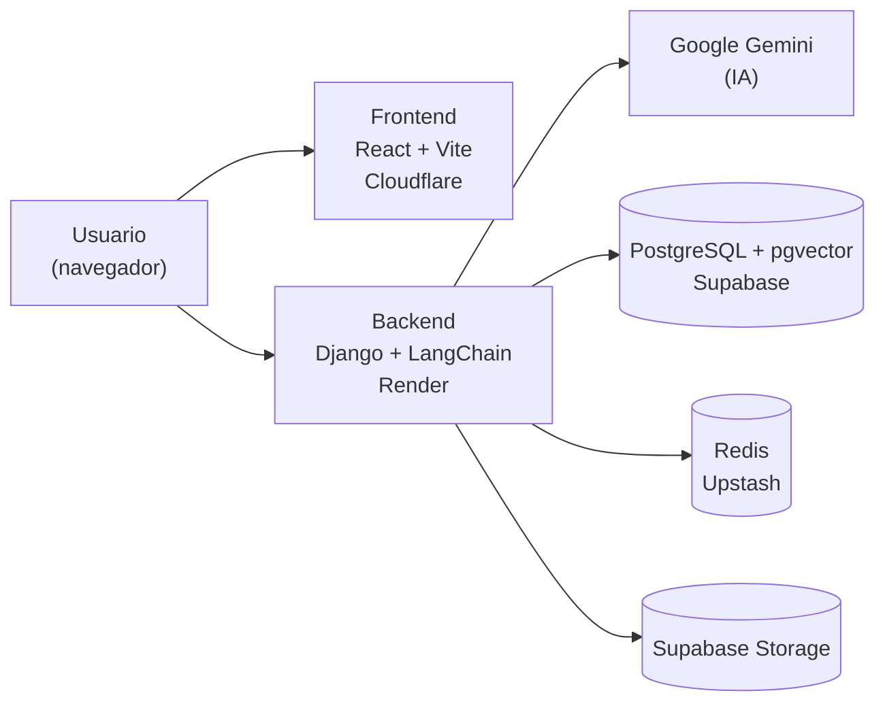

# Epewtufe

**Plataforma de crowdfunding para cómics independientes, con un buscador inteligente basado en IA.**

Proyecto Capstone · Duoc UC · 2026

---

## Descripción

**Epewtufe** es una plataforma web donde los lectores pueden **buscar campañas de cómics independientes y apoyarlas**. Al apoyar una campaña, el lector accede a **adelantos y puede leer el cómic dentro de la plataforma**. El objetivo no es ser un sitio de lectura, sino incentivar el financiamiento de nuevos proyectos.

Para encontrar campañas, la plataforma incluye un **agente de IA conversacional** que recomienda obras según los gustos del usuario (género, estilo visual, autor o cómics similares).

### ¿Qué problema resuelve?

Las plataformas actuales no ayudan a descubrir cómics independientes:

- **Kickstarter** es una plataforma de crowdfunding general: sus filtros de búsqueda son de texto estándar y los cómics quedan mezclados con todo tipo de proyectos. Sus propios usuarios plantean que un mejor motor de búsqueda haría aumentar las donaciones.
- **Webtoon** no cuenta con un buen buscador y su algoritmo favorece las obras masivas, por lo que muchas historias de calidad nunca llegan a sus lectores.

En un sistema de crowdfunding esto es aún más crítico: si los lectores no encuentran una campaña, esta no se financia. Epewtufe resuelve este problema con un **buscador conversacional con IA**, que recomienda campañas según los gustos del usuario y conecta a los creadores independientes con la audiencia que realmente quiere leerlos.

### ¿A quién va dirigido?

- **Lectores y mecenas:** descubren cómics que se ajustan a sus gustos y apoyan las campañas que les interesan.
- **Creadores independientes:** publican sus campañas y ganan visibilidad y financiamiento para sus proyectos.

---

## Tecnologías utilizadas

| Capa | Tecnologías |
|---|---|
| Frontend | React, Vite, TypeScript, Tailwind CSS |
| Backend | Python, Django, Django REST Framework |
| Inteligencia artificial | LangChain, Google Gemini |
| Base de datos | PostgreSQL con pgvector (Supabase) |
| Archivos | Supabase Storage |
| Caché | Redis (Upstash) |
| Nube | Cloudflare (frontend) y Render (backend) |

---

## Arquitectura



- **Frontend:** aplicación web en React que consume la API del backend.
- **Backend:** API en Django que contiene la lógica del sistema y el agente de IA.
- **IA:** el modelo Gemini genera las recomendaciones; los embeddings se guardan en PostgreSQL con pgvector para buscar campañas por similitud.
- **Datos:** PostgreSQL para la información y Supabase Storage para los archivos de los cómics.
- **Caché:** Redis para acelerar las respuestas.

---

## Instrucciones para ejecutar el proyecto localmente

**Requisitos:** Git, Python 3.10+, Node.js 18+, una base de datos PostgreSQL con pgvector y una clave de API de Google AI Studio.

**1. Clonar el repositorio**

```bash
git clone https://github.com/UGONT/Capstone.git
cd Capstone
```

**2. Configurar las variables de entorno**

```bash
cp .env.example .env
```

Completa en el archivo `.env` la conexión a la base de datos, la clave de Gemini y los datos de Redis y Supabase.

**3. Levantar el backend**

```bash
cd backend
python -m venv venv
source venv/bin/activate        # En Windows: venv\Scripts\activate
pip install -r requirements.txt
python manage.py migrate
python manage.py runserver
```

**4. Levantar el frontend** (en otra terminal)

```bash
cd frontend
npm install
npm run dev
```

Abre `http://localhost:5173` en el navegador.

---

## Metodología de trabajo

El equipo trabaja con **Scrum**, organizado en **8 sprints** entre el 28 de agosto y el 27 de noviembre. Cada sprint tiene un objetivo y un hito verificable, y las tareas se gestionan en un backlog con autoasignación según la capacidad de cada integrante.

- **Sprints 1 y 2:** definición del problema, arquitectura y backlog.
- **Sprints 3 y 4:** backend, integración del LLM y prototipo del agente de IA.
- **Sprints 5 a 7:** autenticación, publicación de contenido por creadores y donaciones.
- **Sprint 8:** despliegue, integración de pagos (Transbank) y periodo de prueba.

---

## Integrantes del equipo

| Integrante | Rol |
|---|---|
| Diego Arias | Control de calidad y pruebas |
| Luis Chodil | _Completar_ |
| Benjamín Piñones | _Completar_ |
| Hugo Ahumada | Agente de IA y desarrollo web |
| Diego Vasquez | _Completar_ |

**Docente:** Aldo Martinez
